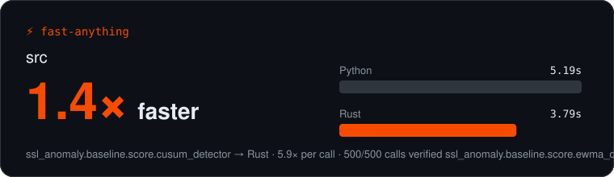

# ⚡ src: 1.4× faster

`/home/asus/miniforge3/envs/geospatial/bin/python ../scripts/bench_fast_anything_parts.py --part detectors --loops 5` went from **5.19s** to **3.79s** (median of 2 runs each, original and Rust interleaved).

| function | per call | checked against |
|---|---|---|
| `ssl_anomaly.baseline.score.cusum_detector` | **5.9×** (32.6µs → 5.6µs) | 500/500 recorded real calls |
| `ssl_anomaly.baseline.score.ewma_detector` | **7.9×** (46.2µs → 5.8µs) | 500/500 recorded real calls |
| `ssl_anomaly.io.patches.aggregate_bin` | **5.4×** (4.9ms → 914.4µs) | 204/204 recorded real calls |

The original code stays in place: set `FAST_ANYTHING_DISABLE=1` to run it, or `fast-anything disable <id>` to remove the switch.

Made with [fast-anything](https://github.com/EL4CTEO/fast-anything)
